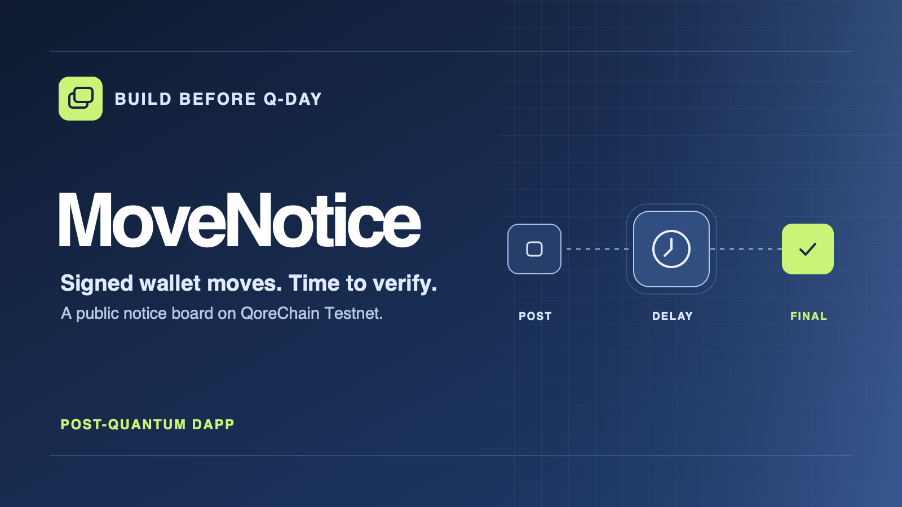

# MoveNotice

MoveNotice is a public notice board for signed, time-locked wallet moves on QoreChain Testnet.

A message that says “we changed wallets, please pay this new address” is easy to fake. A genuine move creates another problem when people keep paying the old address. MoveNotice gives wallets, agents and people a first check they can make before sending.



## How it works

```text
Account A signs A -> B
        |
        v
Anyone relays the signature -> PENDING -> delay elapses -> FINAL
                                  |                          |
                     A signs a cancellation                 v
                                  |                  resolve(A) returns B
                                  v                  GuardedPay refuses A
                       NONE or previous FINAL
```

The signed notice activates at its effective UTC time. Reads see it as final as soon as the chain reaches that time. Anyone can also call `finalize` to emit a dedicated event and materialize the final record. A second post must wait for the pending one to activate or be cancelled. This prevents silent last-minute target swaps. An earlier final target stays in force during the delay on a subsequent move.

GuardedPay forwards native QOR to an unchanged or pending recipient and records whether a notice was pending. A final move makes it revert with `AccountMoved(old, new)`. The sender reviews and rechecks any suggested address before initiating a separate payment.

## Post-quantum protection

- QoreChain admits EVM writes from a coin-60 account with a registered ML-DSA-87 key and a live EVM authorisation window. A hybrid-signed Cosmos message opens that window using both the classical and post-quantum keys. The demo uses a scoped window for just MoveNotice and GuardedPay. Contract creation needs a brief unscoped window. [EVM window reference](https://docs.qorechain.io/developer-guide/evm-window-reference/)
- MoveNotice requires a fresh ML-DSA-87 signature for every post and cancellation, including when a live EVM window already exists. It fetches the key with `pqcKeyStatus` at `0x0000000000000000000000000000000000000a02` and requires algorithm ID 1, proof of possession and a 2,592-byte key. It passes the exact action bytes to `pqcVerify` at `0x0000000000000000000000000000000000000a01`. The relayer supplies the transaction. The account owner supplies the action signature. [QoreChain precompiles](https://docs.qorechain.io/developer-guide/evm-precompiles/)
- A thief with only the classical key cannot post, cancel or replace an existing PQ key. The chain requires hybrid authorization for replacement. A previously unregistered account can still be taken over at first registration. Keep the mnemonic or the recovery code safe and register with proof of possession while you control the account. [QoreChain key binding](https://docs.qorechain.io/build-before-qday/key-binding/)

### Exact signed bytes

Concatenate the following bytes with Solidity `abi.encodePacked`. Tags are literal UTF-8 bytes without a terminator or length prefix. Addresses are 20 raw bytes. Integers are unsigned, fixed-width and big-endian. The signature covers these raw bytes.

| Field | Post bytes | Cancel bytes |
|---|---|---|
| Action and version | `MoveNotice:post:v1` (18) | `MoveNotice:cancel:v1` (20) |
| EVM chain ID | `uint256` (32) | `uint256` (32) |
| MoveNotice contract | `address` (20) | `address` (20) |
| Account | `address` (20) | `address` (20) |
| Target | `address` (20) | |
| Delay in seconds | `uint64` (8) | |
| Current account nonce | `uint256` (32) | `uint256` (32) |
| Signature expiry in Unix seconds | `uint64` (8) | `uint64` (8) |

`postMessage` and `cancelMessage` expose the encoding on-chain. The CLI and browser cross-check the views against the shared TypeScript builder. The tag, chain and contract scope each signature. The signed fields cover the specific account and action. A successful post or cancellation advances the nonce. A signature is valid only through its expiry, inclusive. The Foundry and TypeScript tests share a [golden vector](shared/golden.json).

## Contracts and public events

The only supported network is **QoreChain Testnet**, Cosmos `qorechain-diana`, EVM `9800` (`0x2648`). Switch the explorer to Testnet when following transaction links. [Network details](https://docs.qorechain.io/appendix/networks/) · [Explorer](https://explore.qore.network)

| Entry | EVM address | QoreChain address |
|---|---|---|
| MoveNotice | TBD after deployment | TBD after deployment (qor1…) |
| GuardedPay | TBD after deployment | TBD after deployment (qor1…) |
| Demo deployer | TBD after deployment | TBD after deployment (qor1…) |

The deploy command saves confirmed public addresses, deployment block and transaction hashes to `deployments/testnet.json`. The `pnpm notice resolve <address>` command shows the EVM and `qor1…` encodings of the same 20 bytes. `pnpm notice status` shows both encodings for the configured account.

- `MovePosted(account, to, nonce, postedAt, effectiveAt, relayer)`
- `MoveCancelled(account, to, nonce, relayer)`
- `MoveFinalized(account, to, effectiveAt)`
- `Paid(sender, to, amount, movePending)`

Move events index `account` and `to`. Derive a move’s status from its events and chain time, or call `resolve`. `resolveFinal` follows up to eight final links and stops before revisiting an address. A returned endpoint can still have an outgoing link when traversal reached a cycle or the cap. The web lookup checks the last 50,000 blocks at most in requests spanning at most 10,000 blocks each and caches the pages in memory. A configured deployment block bounds this search.

## Run locally

Install Node 22.13 or later, pnpm 11, and Foundry. The one-time Forge setup downloads a checksum-verified Solidity 0.8.28 compiler and pinned forge-std inside the project. It supports macOS and Linux x64 out of the box. On another platform, supply a native 0.8.28 compiler at `contracts/.toolchain/solc` before running the setup.

```sh
pnpm install --frozen-lockfile
pnpm setup:forge
pnpm test
pnpm build
pnpm dev
```

Open the local address printed by Vite. Without deployed addresses the app shows its setup state. The tests and build run offline after installation. The browser sends read requests to the public testnet EVM RPC when configured. For the REST window status in production, set `VITE_QORE_REST_URL` to a CORS-enabled testnet REST origin or proxy the `/lcd-testnet` path to `https://api-testnet.qore.host`, stripping the path prefix. Vite dev and preview include that proxy.

## Deploy to Testnet

Use a throwaway coin-60 account. In QoreX, choose **Add an Ethereum account (coin 60)**. Keep real funds and credentials out of the project.

1. Copy `.env.example` to a local `.env`. Set `QORE_MNEMONIC` for the coin-60 account at index 0, or set `PRIVATE_KEY` and its matching `QORE_PQC_RECOVERY_CODE`. For a fresh raw key, run `pnpm notice recovery-code` privately and store the code offline, apart from the private key. Reuse the same code for that account.
2. Run `pnpm notice status` to view the `qor1…` address. Fund it with test QOR using the [testnet faucet](https://dashboard.qorechain.io/faucet).
3. Run `pnpm notice register`, then `pnpm notice status`. Verify that the key is registered, proven and matches the local key. Registration is idempotent.
4. Run `pnpm notice window:deploy` followed immediately by `pnpm deploy:testnet`. The deploy window allows 600 blocks, three transactions and 2 QOR of value plus fees. The script uses a 600-second minimum delay by default. If deployment is refused, inspect status and the local receipts before retrying.
5. Run `pnpm notice window:scoped`. This replaces the deploy window with 1,200 blocks, eight transactions, a 2 QOR value-and-fee budget and the two deployed addresses as its allowed targets. Reopen it if it expires or runs out of capacity.
6. Copy the two public addresses into `MOVENOTICE_ADDRESS` and `GUARDEDPAY_ADDRESS` in the root `.env`, or let the CLI read the manifest. Copy `web/.env.example` to `web/.env`, set the two `VITE_` contract addresses and `VITE_DEPLOYMENT_BLOCK` from the manifest, then restart Vite.
7. Follow [DEMO.md](DEMO.md) to prepare and record the demo. Complete both [QCAI audit stages](audit/README.md) before submission.

```sh
pnpm notice help
pnpm notice sign-post <target> 600 --valid 3600
pnpm notice submit <file.json>
pnpm notice sign-cancel --valid 3600
pnpm notice resolve <qor1-or-0x-address>
pnpm notice simulate-pay <recipient> 0.01
```

The CLI writes only public action data into `notices/`. Treat a signed JSON file as permission to relay that action until its nonce or expiry makes it stale. Import it into the web app to review its exact message and simulate. QoreX uses the CLI for submission. For other testnet wallets, the browser uses a request with no transaction data to look for evidence that the provider implements sending. Wallets can refuse that probe or a subsequent send. The CLI remains available. The window and the sender’s test QOR are still required for a write.

## Limits

- Use the board as a first check and verify a changed address with its owner through a trusted channel. A typo can become a signed destination, and the delay helps when someone is watching.
- Protection for posting and cancelling depends on a proven registered key. The first registration of an unregistered account can be seized by someone holding its classical key. A mnemonic can recover both keys, so anyone who obtains it can recover both.
- Wallets and agents opt into checking MoveNotice. Direct transfers can still go to a stale address.
- QoreX currently supplies an address for reads. The local CLI handles ML-DSA-87 signing and holds the key outside the browser. The required precompiles are active on Testnet. [QoreX integrations](https://docs.qorechain.io/developer-tools/qorex-integrations/)
- The ten-minute demo delay makes the flow watchable. Allow 48–72 hours for actual operations so more watchers have time to respond. One ML-DSA-87 signature adds about 4.6 KB of calldata, and verification alone costs roughly 85–90k gas.
- The current evidence is local automated testing. A human security audit and the two QCAI runs are pending.

## Fest and credits

Solo entry in the **Post-Quantum dApp** category for Build Before Q-Day. Submissions close **2 December 2026 at 23:59 UTC**. The [demo plan](DEMO.md), [AI usage](AI_USAGE.md), [test results](TEST_RESULTS.md) and [audit workflow](audit/README.md) are in this repository. [Fest rules](https://build.qorechain.io/rules) · [Track conditions](https://build.qorechain.io/prizes)

- Scaffolding used the official `create-qorechain-dapp@0.14.0` **foundry** and **viem-wagmi** templates. Precompile mocking, raw action signing and native window handling follow the Apache-2.0 QDayVault workshop patterns. [QoreChain docs](https://docs.qorechain.io/) · [QDayVault workshop](https://github.com/qorechain/build-before-qday/tree/main/workshop-2/01-qday-vault)
- `@qorechain/sdk` supplies account, key, notice signing and native transaction helpers. `@qorechain/evm` supplies the testnet definition and window reads. `@qorechain/pqc` supplies real ML-DSA-87 in the test suite. `@qorechain/qorex-rainbowkit` provides the QoreX EIP-1193 discovery helper. wagmi and RainbowKit are the original web template’s wallet-stack libraries and peer dependencies of the wallet kit. [QoreChain developer packages](https://docs.qorechain.io/developer-tools/qorex-integrations/)
- Foundry, forge-std and Solidity compile, deploy and test the contracts. viem supplies EVM encoding, reads, simulation and CLI sending. CosmJS Stargate provides the native transport. [Foundry](https://getfoundry.sh/) · [Solidity](https://soliditylang.org/) · [viem](https://viem.sh/) · [CosmJS](https://github.com/cosmos/cosmjs)
- Vite and its React plugin, React and React DOM, TypeScript, tsx, Vitest, Testing Library and jsdom provide the build and test stack. The cover uses project artwork rendered from SVG with the system image tool. [Vite](https://vite.dev/) · [React](https://react.dev/) · [TypeScript](https://www.typescriptlang.org/) · [tsx](https://tsx.is/) · [Vitest](https://vitest.dev/) · [Testing Library](https://testing-library.com/) · [jsdom](https://github.com/jsdom/jsdom)
